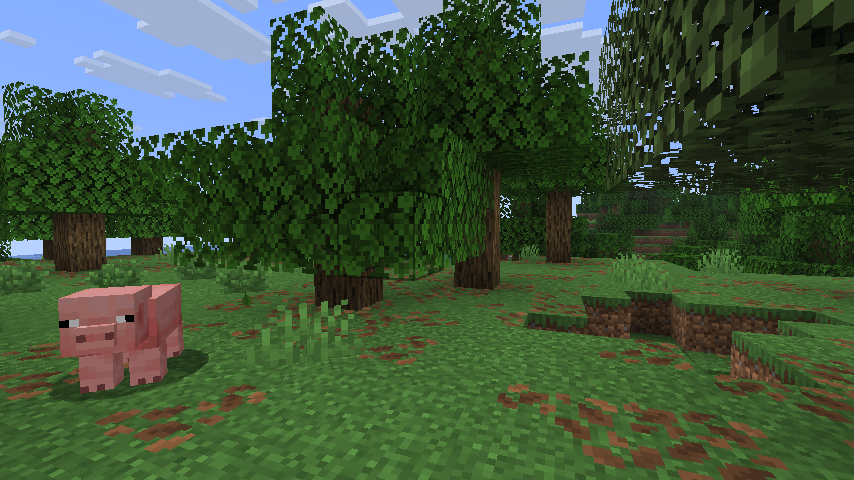
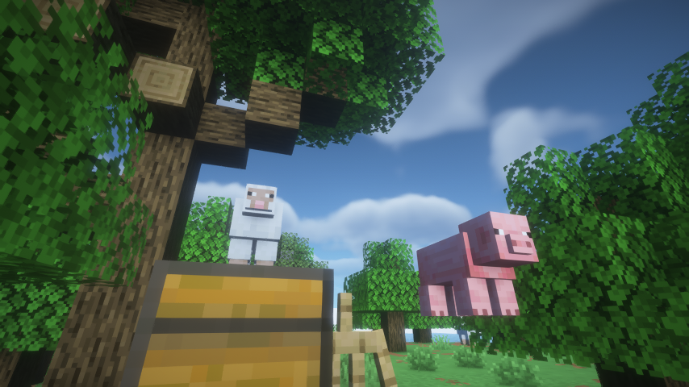

# Vulkan Iris

A fork of [Iris Shaders](https://github.com/IrisShaders/Iris) that renders shader packs through a native Vulkan backend.
Instead of wrapping OpenGL, it borrows the Vulkan device of the renderer that owns the game (Polydium today).

**Work in progress — not usable for playing yet.** Detailed status per phase: [docs/vulkan-iris](docs/vulkan-iris).

## Rules this project follows
- **Native Vulkan only.** No GL wrapping and no fake implementations. If something isn't supported, Vulkan Iris refuses it with a clear message; it never silently falls back to GL.
- Iris's own pack loader, patcher, option system and uniform code are reused, so packs behave as they do on Iris.
- Every claim is backed by a test on real hardware, and performance claims need benchmarks. Each phase document lists what was tested and what is not implemented yet.

## Status

| Phase | What | State |
|---|---|---|
| 1 | Architecture audit (Iris, Sodium, Polydium, VulkanMod, Mojang Vulkan) | done |
| 2 | Vulkan device / capability probing, vendor feature catalogue | done |
| 3 | "First light": own SPIR-V pipeline drawing into Polydium's frame | passed in-game |
| 4 | Resources: VMA, render targets, layouts, descriptors, deferred destruction | passed (13 GPU tests + in-game) |
| 5 | Shader packs → SPIR-V: Iris patcher → Vulkan GLSL → shaderc | 275 / 275 programs from 10 packs |
| 6 | Native post chain (setup / begin / prepare / deferred / composite / final, compute, custom images) on the live frame | 10 / 10 packs render in-world |
| 7 | gbuffers + shadow pass (the world drawn with the pack's shaders) | 7a+7b+7c: terrain, entities, block entities, sky, particles, clouds and the hand drawn with the pack's gbuffers programs, 10 / 10 packs; 7d: the shadow pass (terrain, entities, block entities) with the pack's shadow and shadowcomp programs (compute and fragment, with flipping; shadow.csh; HW samplers), 10 / 10 packs + a self-test pack ([status](docs/vulkan-iris/PHASE7_STATUS.md)); 7e: `at_tangent` / `mc_midTexCoord` derived per quad on the GPU (fixes Noble's black glass); entity IDs and the rest of the 7e sweep next |
| later | DH/Voxy, VulkanMod adapter, native Vulkan in Minecraft 26.x, other loaders and clients | planned |

Tested so far on an NVIDIA RTX 5060 (driver 610.88), Minecraft 1.21.11, Fabric, Polydium 1.4.21.

**Performance:** [A/B benchmark against Iris on GL](docs/vulkan-iris/BENCHMARK.md), same jar and scene. Vulkan Iris is
faster in 6 of 10 packs (average FPS) and slower in 4, so it is not faster than Iris overall yet. Per-stage GPU times on both sides show where it loses.

AMD, Intel and integrated GPUs are targets, but **have not been tested yet**.

Packs used for testing: Bliss, BSL, Complementary Reimagined and Unbound, MakeUp UltraFast, Mellow, miniature, Noble,
Sildur's Vibrant and Solas. These packs are not part of this repository.

| Vanilla (Polydium) | BSL: terrain, entities, sky and post chain on Vulkan |
|---|---|
|  |  |

## Layout
- `vulkan/`: the Vulkan core (`dev.vulkaniris.vk`), plain Java 21 + LWJGL. Unit-tested on the real GPU with `gradlew :vulkan:test`.
- `common/.../pipeline/transform/vulkan`, `common/.../pipeline/vulkan`: Iris-side translation to Vulkan GLSL and the uniform writer.
- `fabric/src/main/java/dev/vulkaniris/fabric`: the Minecraft side. It borrows Polydium's device, hooks the frame and runs the post chain and the in-game self-tests.

## Building and testing
Gradle must run on **JDK 25** (the mods target Java 21). The fork is based on Iris 1.10.8 for Minecraft 1.21.11.

```
gradlew build
gradlew :vulkan:test
gradlew :fabric:prodPhase6 -Dvulkaniris.phase6.packs=bsl,noble
gradlew :fabric:prodPhase7 -Dvulkaniris.phase6.packs=bsl,noble
```

The in-game self-tests (`prodFirstLight`, `prodPhase4`, `prodPhase5`, `prodPhase6`, `prodPhase7`) start a real client. They need the
jars listed in `run-deps/README.txt` (Polydium and its dependencies are not redistributed here) and packs in
`fabric/run-prod/shaderpacks`.

## Licence and credit
Licensed like Iris: **LGPL-3.0-only** (see [LICENSE](LICENSE)).
Credit goes to the Iris team and contributors, whose full history this repository keeps; code adapted from other projects
is credited in each file. Vulkan Iris is not affiliated with Iris, Sodium, Polydium or VulkanMod.
