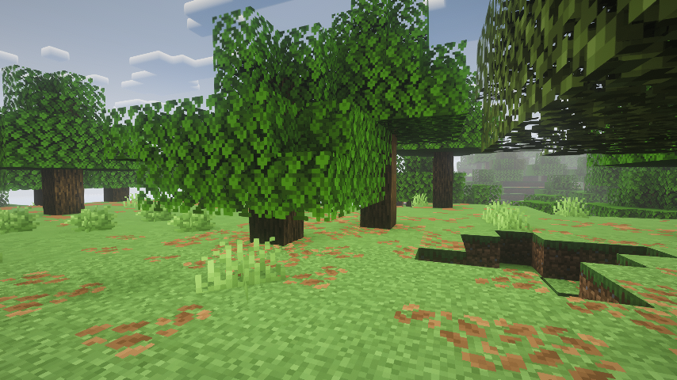
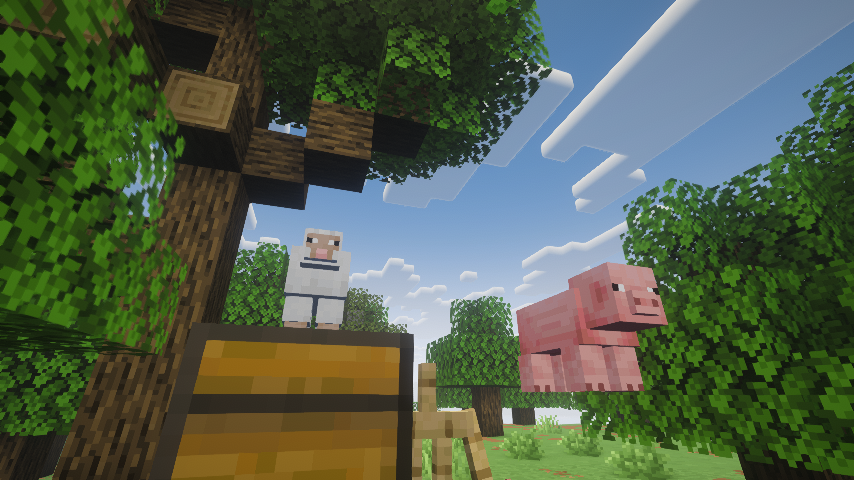
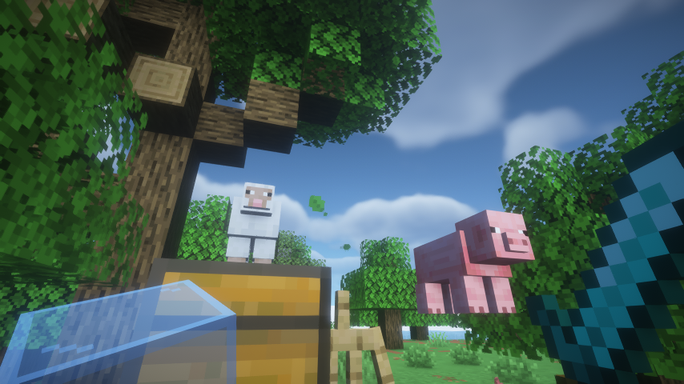
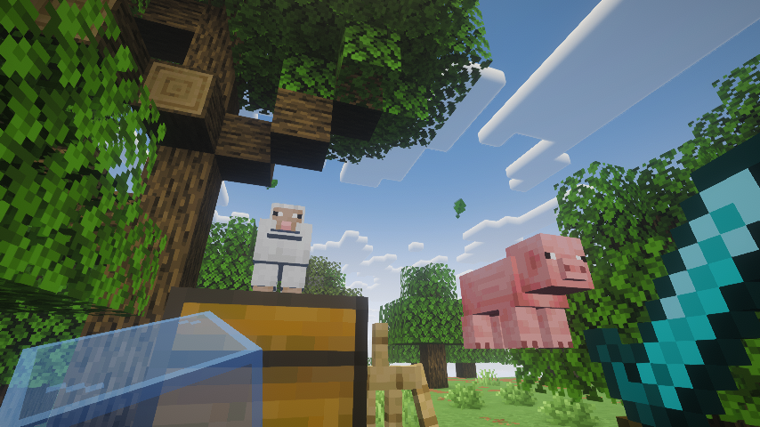
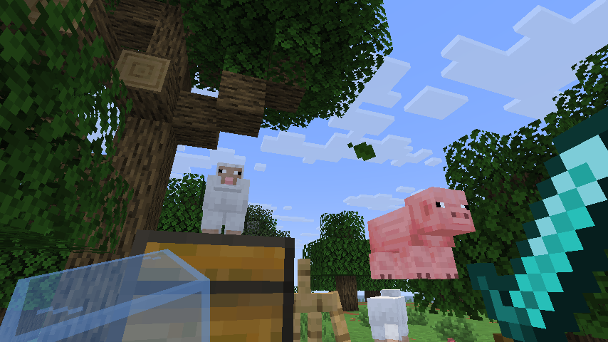
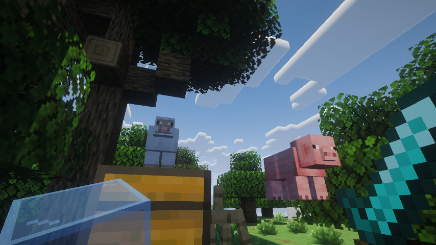
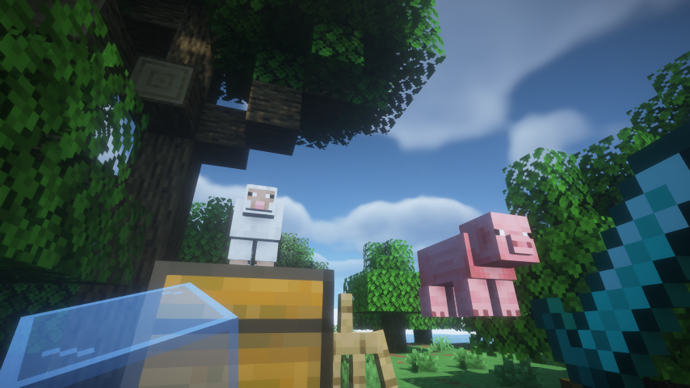
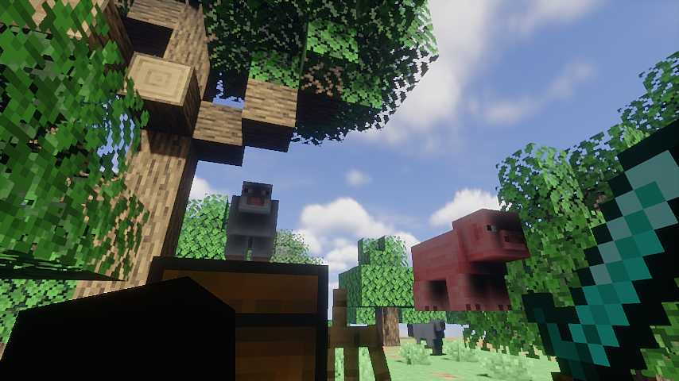
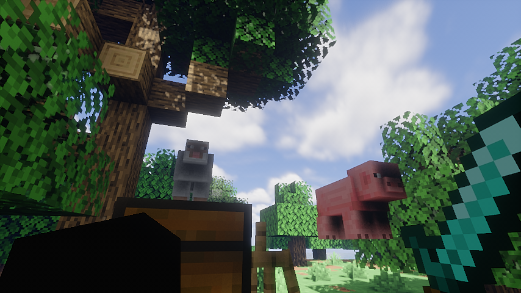

# Phase 7 — gbuffers: status (slices 7a + 7b + 7c + 7c gaps)

7a + 7b (terrain) are below; 7c (entities, block entities, sky, particles) is at the end:
[Slice 7c](#slice-7c--vanilla-geometry-with-the-packs-programs).

**Result: on Polydium's live in-world frame, 10 / 10 real shader packs draw the world's terrain with their own
`gbuffers_terrain` / `_cutout` / `gbuffers_water` programs, natively on Vulkan.** Their deferred / composite / final
chain then runs on that gbuffer data. Tested on an RTX 5060 (NVIDIA 610.88, Vulkan 1.4.341), Minecraft 1.21.11, Polydium 1.4.21 and Sodium 0.8.14.

Test: `./gradlew :fabric:prodPhase7` (`-Dvulkaniris.phase7.selftest`), optionally `-Dvulkaniris.phase6.packs=bsl,noble`.
It uses the same world as Phase 6 (`vulkaniris-phase6`, seed 6). For each pack it builds the chain and its terrain programs, then
switches Sodium to the pack's vertex format and rebuilds every chunk. It waits 240 frames for the rebuild, records 90 more frames, then saves
`run-prod/vulkaniris-phase7/<pack>.png` and `run-prod/vulkaniris-phase7.txt`.

A pack passes when all of these hold:
- every program built
- every terrain pass drew with the pack's program, with no error
- the output is not flat
- the screenshot was checked by eye

In the same session the Phase 6 test (`prodPhase6`) still passes 10 / 10.

| Pack | Terrain programs used | Vertex stride | Result |
|---|---|---|---|
| Bliss 2.1.2 | gbuffers_terrain, gbuffers_terrain, gbuffers_water | 32 B | pass |
| BSL 10.1.3 | gbuffers_terrain, gbuffers_terrain, gbuffers_water | 32 B | pass |
| Complementary Reimagined r5.9.3 | gbuffers_terrain, gbuffers_terrain, gbuffers_water | 32 B | pass |
| Complementary Unbound r5.9.3 | gbuffers_terrain, gbuffers_terrain, gbuffers_water | 32 B | pass |
| MakeUp UltraFast 9.4b | gbuffers_terrain, gbuffers_terrain, gbuffers_water | 32 B | pass |
| Mellow 3.5 | gbuffers_terrain_solid, gbuffers_terrain, gbuffers_water | 32 B | pass |
| miniature 2.19 | gbuffers_terrain, gbuffers_terrain, gbuffers_water | 32 B | pass |
| Noble 1.9.9 | gbuffers_terrain, gbuffers_terrain, gbuffers_water | 36 B | pass |
| Sildur's Vibrant 2.02 Extreme | gbuffers_textured, gbuffers_textured, gbuffers_water | 32 B | pass |
| Solas 3.7b | gbuffers_terrain, gbuffers_terrain, gbuffers_water | 32 B | pass |

Each pack drew 988–990 terrain passes over 330 frames. No region was skipped for being in the old vertex format.
The run exits cleanly, with no device loss and 0 images leaked.

| Vanilla (Polydium) | BSL | Complementary Reimagined | Noble |
|---|---|---|---|
|  |  |  |  |

More screenshots: [Bliss](phase7/bliss.png), [Solas](phase7/solas.png), [Sildur's](phase7/sildurs.png).
The camera differs a little from pack to pack because the player settles while chunks rebuild.

## How it works
**7a — extended chunk vertices.** Polydium strips all of Iris's mixins on Vulkan. Vulkan Iris re-applies the CPU-side
ones that put Iris's data into Sodium's chunk vertices:
- `MixinChunkVertex`, `MixinChunkVertexConsumer`, `MixinChunkMeshBuildTask`
- the block and fluid renderers (including the Fabric `FluidRendererImpl` one)
- `MixinAbstractBlockRenderContext`, `MixinBlockModelPart`
- `MixinRenderRegionArenas`, `MixinRenderSectionManager`

They are copied from Iris (LGPL, credited in each file) as `*Port` mixins. `VulkanIrisMixinPlugin` applies them only when
Polydium's `IrisVulkanGate.applied` is true, so they never duplicate Iris's own. Iris's `FormatAnalyzer` picks the format from the
attributes the pack's programs read (`mc_Entity`, `iris_Normal`, `mc_midTexCoord`, `at_midBlock`), as Iris does after linking.
Chunks are then rebuilt with `LevelRenderer.allChanged()`.

**7b — terrain drawn with the pack's programs.** `MixinSodiumVulkanPort` intercepts Polydium's private `SodiumVulkan.draw`.
That method is called after Sodium's batches, the index buffer capacity and the chunk data are prepared. `TerrainHook` walks the
same regions and batches Polydium would. These facts were read from Polydium's bytecode; none of its code is copied:
- regions without storage, resources or a batch are skipped
- the index buffer is the shared quad buffer, or the region's own for sorted translucency
- region offset = (origin − camera int) − camera fraction
- time = now − region creation time

`PostChain` then draws each region with the pack's program:
- **Programs:** Iris's `ProgramFallbackResolver` for TerrainSolid / TerrainCutout / Water, `patchSodium`, then `VulkanGlslTranslator`.
  `u_RegionOffset` and `iris_CurrentTime` become push constants.
- **Uniforms:** a second uniform writer with Iris's `SodiumShader` set: PER_VERTEX fog, builtin replacements, the model-view / projection /
  normal matrices and their inverses, `u_TexCoordShrink`, `iris_TexelSize`, and the alpha test reference (Iris's defaults:
  none / half / non-zero).
- **Samplers:** Iris's `addGbufferOrShadowSamplers` rules:
  - atlas and lightmap: Polydium's own textures
  - colortex4+ only; colortex0–3 are not sampleable in gbuffers on Iris, so they read texture unit 0, the atlas
  - custom textures of the gbuffers stage
  - `normals` / `specular`: Iris's flat defaults
  - `iris_ChunkData`: Polydium's per-region chunk-fade buffer
- **Pipeline:** the vertex format is Sodium's compact layout plus Iris's attributes, at FormatAnalyzer's offsets.
  - Depth test LEQUAL with depth writes; back faces culled.
  - Front face is clockwise: Polydium keeps GL's row order without a y flip, which mirrors GL's winding.
  - Blending: Sodium's translucent blend for water, plus the pack's blend directives.
- **Draw:** one descriptor set per region, because each region's chunk data differs. Then indexed draws from the region's batch.
- **Frame split:** the chain now runs in three parts recorded between Polydium's passes, each wrapped in Polydium's full barrier:
  - `beginLevel` (begin, prepare) at the first terrain draw
  - `beforeTranslucent` before water: the depth copy for depthtex1, centre depth, and deferred, where Iris runs it
  - `endLevel` (composite, final, copy-back) after the world

### Found and fixed on the way
- **Unused inputs and samplers.** GL drops inputs and samplers that are declared but never read; the translator now drops them too.
  Before, BSL's `at_tangent` (renamed by Iris's patch) and Complementary's unused `colortex6` made pipelines fail.
- **Feedback loop.** Sildur's `gbuffers_water` really samples colortex4 while drawing into it, a GL feedback loop.
  It now samples a copy taken just before the pass, which is what GL returns in practice (reported in the notes).
- **Composite blend directives.** These are now implemented; Phase 6 ignored them. Noble's exposure and bloom passes need them: without them Noble's image was washed out to white.
- **Test harness: destroying too early.** The harness destroyed a pack's chain, and at the end every Vulkan object, while the
  frame being recorded still referenced them. This caused a device loss on the second pack and a rare crash at shutdown.
  Destruction now waits for that frame's submission.
- **Stale vertex stride.** Each region's arena stride is checked: a region still meshed in another format is skipped, never read
  past its end. None occurred in the tests.

## Not implemented yet (reported in the notes, never faked)
- **7c leftover:** `iris_Entity` / `mc_Entity` of Iris's extended entity vertex format read GL's default (0,0,0,1), and
  the `entityId` / `blockEntityId` uniforms are not driven. See "Entity IDs" in the 7c section. (`at_tangent` and
  `mc_midTexCoord` are derived since 7e, see [7e: derived at_tangent / mc_midTexCoord](#slice-7e--derived-at_tangent--mc_midtexcoord).)
- **7d:** no shadow pass: `shadow*` samplers are a "nothing occludes" stand-in, and `shadowcomp` doesn't run.
- **depthtex in gbuffers:** depthtex0/1/2 read the depth before translucent terrain. In the opaque passes that is the previous frame's copy.
  GL would sample the depth buffer being drawn.
- **PBR:** `normals` / `specular` atlases are not loaded; Iris's defaults are used.
- **Not driven yet:** tessellation in terrain programs, per-region descriptor-set reuse (a performance item),
  `blendFunc`, and the `gbufferPrevious*` uniforms Iris itself doesn't provide.
- **Validation:** the Khronos validation layer has still not been run (not installed on the test machine).
  Only NVIDIA has been tested.
- **No benchmark yet.** The test's CPU record times (0.1–2.7 ms per frame for the whole chain) are not a benchmark.

# Slice 7c — vanilla geometry with the pack's programs

**Result:** entities, block entities, the sky (sky disc, sunrise/sunset, stars, sun and moon), particles and the entity
shadow decal are now drawn with the pack's `gbuffers_entities` / `_block` / `_skybasic` / `_skytextured` / `_textured(_lit)`
programs into the colortex targets, on Polydium's live frame. **10 / 10 packs pass** `prodPhase7` with no vanilla draw
error. Over 330 frames each pack draws about 3,000–3,300 entity draws, 660–1,650 sky draws and 330–420 particle draws
with its own programs (miniature: none, see below), in about 5,000–5,600 redirected Polydium passes. `prodPhase6` still passes 10 / 10. The run exits with 0 images leaked.
Screenshots were checked by eye; every pack is set to noon at its start.

| BSL | Complementary Reimagined | Noble |
|---|---|---|
|  |  |  |

More: [Bliss](phase7/7c-bliss.png), [Solas](phase7/7c-solas.png), [Sildur's](phase7/7c-sildurs.png). Not every pack
has every program; Iris's fallback chain decides which one draws, e.g. Sildur's draws entities with `gbuffers_textured`
and Solas the sky with `gbuffers_basic`.

**Gap found (closed in 7c gaps, below):** when a pack has no program anywhere in a key's fallback chain, Iris draws
with its own synthesized fallback shader. Without it, miniature was missing particles, the sun and the moon.

The test now summons a pig, a sheep and an armor stand and places a chest in front of the player (vanilla commands
on the integrated server; earlier runs' entities, tagged `vi7c`, are removed first). The report lists, per pack, the
draws per pack program and every vanilla pipeline seen while the pack was active.

## How it works
- **Which program:** Iris's own mapping, `IrisPipelines.getPipeline(pipeline)` → `ShaderKey`, then Iris's
  `ProgramFallbackResolver` for that key's program. Each key is patched with Iris's `patchVanilla`, translated with
  `VulkanGlslTranslator` and compiled once per pack; pipeline variants (vertex format, blend, depth, cull) are built at
  a pipeline's first draw.
- **Where it hooks** (facts read from Polydium 1.4.21's bytecode; nothing copied):
  - `VulkanCommandEncoder.createRenderPass(descriptor)` and `VulkanDeferral.continueSuspendedPass(descriptor)` — Polydium
    merges consecutive passes on the same targets, so most world passes come from the second one. A pass is redirected
    when its single colour attachment is Minecraft's main colour and its depth (if any) the main depth.
  - `VulkanRenderPass.drawIndexed(IIIII)` / `draw(IIII)`: every non-indirect draw ends in one of these.
- **The swap:** at the first redirected draw Polydium's dynamic-rendering scope is ended. The same draw (same vertex and
  index buffers, same `vkCmdDraw*` arguments, same `DynamicTransforms` / `Projection` / `Fog` / `Globals` uniform blocks and
  the bound textures) is recorded with the pack's pipeline into its `DRAWBUFFERS` + the main depth. Before Polydium's next own
  draw, multi-draw, indirect draw, push constant or `close()`, its scope is begun again with the same attachments
  (load/store), its pipeline, viewport and scissor re-bound and its `VulkanDynamicState` cache reset.
- **Sky:** Polydium draws the sky with its own far-plane copies of vanilla's sky pipelines (public constants in
  `SkyFarPlane.Pipelines`). They are mapped back to the vanilla pipeline they replace, so the pack's sky programs run
  with vanilla's state, as on GL.
- **Frame start:** the pack's frame now begins at `LevelRenderer.renderLevel` HEAD, because the sky is drawn before terrain.
- **Inputs vanilla formats don't have** (e.g. `iris_UV1` for particles, `mc_Entity`) read a constant vertex binding
  with GL's default attribute value (0,0,0,1), as GL does for a disabled attribute.

## Limits (all reported in the notes)
- Iris's extended entity attributes and the `entityId` / `blockEntityId` uniforms: see "Entity IDs" below
- a program that samples a target it draws into reads a copy taken at its first draw of the frame
- the uniform block is filled once per program per frame
- performance items, not measured: one descriptor set per draw; pipeline variants built lazily at first use
  (a stutter the first time a pipeline is seen); legacy (non-dynamic-rendering) Polydium passes are not handled

# 7c gaps — fallback shader, clouds, hand

**Result:** `prodPhase7` passes **10 / 10** packs. Over 330 frames:
- every pack draws the clouds with its own program, 331 draws each (`gbuffers_clouds`; BSL uses `gbuffers_textured`)
- every pack draws the hand with its own program, 331 hand passes each (`gbuffers_hand`, `gbuffers_hand_water`)
- miniature draws 10 keys with Iris's synthesized fallback shader, including particles, the sun and the moon

`prodPhase6` passes 10 / 10, and `:vulkan:test` passes 11 / 11. The test now puts a diamond sword in the main hand and
light-blue stained glass in the off hand, so the solid and the translucent hand are both drawn.

| BSL | Complementary Reimagined | miniature (fallback shader) |
|---|---|---|
|  |  |  |

## How it works
- **Fallback shader.** When `ProgramFallbackResolver` finds nothing for a key, Iris's own
  `ShaderSynthesizer.vsh/fsh` builds the program, with the same inputs Iris passes on GL: the key's vertex format,
  lightmap, glint, text, fog mode, diffuse lighting and leash. The synthesized fragment shader writes colortex0 only.
  - Its vanilla names (Position, Color, UV0–UV2, Normal, LineWidth) map to the vertex format.
  - Its uniform blocks map to the pass's blaze3d blocks: Projection, DynamicTransforms, Globals, Fog, Lighting.
  - `Sampler0–2` map to the pass's textures.
  - The loose uniforms `AlphaTestValue`, `FogDensity` and `FogIsExp2` come from Iris's `CapturedRenderingState`.
  - The one change made for Vulkan is an explicit `layout(location = 0)` on `fragColor`, because SPIR-V requires one.
- **Clouds.** Vanilla 1.21.11 reads cloud cells from a `samplerBuffer` (`CloudFaces`, `R8_SINT`). Packs now see it as a
  `VK_DESCRIPTOR_TYPE_UNIFORM_TEXEL_BUFFER` whose buffer view covers the same buffer slice. Views are cached per buffer,
  offset, range and format, and destroyed deferred, once the frames that use them have finished.
- **Hand.** This is a port of Iris's `HandRenderer` as `VulkanHand` (LGPL-3.0, credit: the Iris team), with Iris's injection points:
  - the solid hands at the main pass's second `endBatch`, after a depth copy for `depthtex2` (depth without the hand)
  - the translucent hands at the end of the level
  - vanilla's own hand pass after the level is skipped

  The hands go through the same redirect as other vanilla draws. Iris's `HandRenderer.isActive()` and
  `isRenderingSolid()` also report the Vulkan hand, so Iris's `gbuffers_hand` / `_hand_water` mapping picks the right programs.

## Entity IDs (not done: documented, not faked)
Iris writes per-vertex entity, block entity and item IDs (`iris_Entity`) and entity `mc_midTexCoord` / `at_tangent`
through an extended vertex format. It needs three things:
- a `BufferBuilder` mixin that widens `NEW_ENTITY` / `BLOCK` / `POSITION_COLOR_TEX_LIGHTMAP` buffers
- a `RenderPipeline.getVertexFormat` mixin
- about 15 mixins that track the entity currently rendered

Porting it on Polydium is not a contained change. The widened buffers would also reach the Polydium pipelines this
fork doesn't redirect, such as GUI items, and those still expect vanilla's vertex layout. An ID per draw is not an
option either: entities are batched by render type, so one draw holds many entities. Until this is ported, the
ID attributes read GL's default (0,0,0,1) and every affected program says so in the notes. The two attributes that
depend only on the quad's own vertices, `at_tangent` and `mc_midTexCoord`, are computed in the vertex shader since 7e
(see [below](#slice-7e--derived-at_tangent--mc_midtexcoord)).

# Slice 7d — shadow pass (terrain)

**Result:** in all 10 packs the shadow map is rendered with the pack's own `shadow` programs and read by its deferred,
composite and gbuffers programs. `prodPhase7` passes **10 / 10**. Over 330 frames each pack runs 330 shadow passes
with about 978 shadow terrain passes (Sodium's solid, cutout and translucent layers from the shadow view). Each pack
uses its own `shadowMapResolution` (512 to 3072) and the shadow culling Iris would pick (Advanced or Safe Zone frustum
culling, distance-capped). `prodPhase6` still passes 10 / 10, and `:vulkan:test` passes.

| Complementary Reimagined | BSL | Noble without shadow draws (A/B) | Noble with shadows |
|---|---|---|---|
|  |  |  |  |

The A/B images come from the same scene. Run with `-Dvulkaniris.phase7.noshadow=true`, the shadow maps stay cleared, so
nothing occludes and the trunk and ground under the tree are lit. With the shadow pass they are shaded.

## How it works
- **When.** The hook is at `LevelRenderer.renderLevel`, right after `prepareCullFrustum`, Iris's own point
  (`iris$renderTerrainShadows`). It runs the shadow pass and then the pack's `prepare` stage, as
  `IrisRenderingPipeline.renderShadows` does. `begin` stays at `renderLevel` HEAD, so the frame order is the same as
  Iris's: begin → shadow → shadowcomp → prepare → the world.
- **View.** The shadow view comes from Iris's own code:
  - `ShadowRenderer.createShadowModelView`
  - `ShadowMatrices.createOrthoMatrix` (or `createPerspectiveMatrix` with `shadow.fov`)
  - a port of `ShadowRenderer.createShadowFrustum` (`VulkanShadow`): non-culling, box, Advanced or Safe Zone
    frustum, chosen the same way, including Iris's voxelization guess (a geometry shader or image stores in the shadow programs)
- **Sections (CPU).** Iris's Sodium shadow mixins are ported unchanged as `*ShadowPort` (LGPL-3.0, credit: the Iris
  team): `MixinRenderSectionManagerShadow`, `MixinRenderRegion`, `MixinRenderRegionManager` and the terrain part of
  `MixinSodiumWorldRenderer`. Sodium keeps separate shadow render lists and batches while Iris's
  `ShadowRenderingState` is set. With that state set, Vulkan Iris calls Sodium's public API the way Sodium's own
  `LevelRenderer` mixin does: `setupTerrain` with the shadow frustum's viewport and the shadow
  `ChunkRenderMatrices`, then `drawChunkLayer` for the opaque and translucent groups. Smart culling is off, as in Iris.
  Nothing from Sodium or Polydium is copied.
- **Draws (GPU).** Sodium's draws reach Polydium's `SodiumVulkan.draw` as usual. In shadow state, `TerrainHook` hands
  them to the pack's shadow programs (Iris `SodiumPrograms`: `shadow_solid` / `_cutout` / `_water`, falling back to
  `shadow`). The shadow programs are built and patched like the terrain programs (`patchSodium`). The chunk vertex
  format now covers what the shadow programs read too, as in Iris. They draw into:
  - `shadowtex0` (D32), at the pack's resolution, with no backface culling (Iris disables it in the shadow pass)
  - the pack's `shadowcolorN`, in their formats; unknown draw buffers = {0, 1}, as in Iris
- **Targets.**
  - `shadowtex1` is copied from `shadowtex0` before translucent shadow terrain.
  - Depth is cleared to 1 every frame, and `shadowcolorN` to its clear colour when it clears (Iris's per-frame shadow clears).
  - Samplers follow Iris's `IrisSamplers.addShadowSamplers`: `shadow` is `shadowtex1` when the program declares
    `watershadow`, else `shadowtex0`.
  - `sampler2DShadow` gets a depth-compare sampler; the filter follows `shadowHardwareFiltering` / `shadowNearest`.
  - Depth is sampled through a view that reads (depth, depth, depth, 1), Iris's GL texture swizzle.
- **shadowcomp.** The packs' `shadowcomp` compute programs run after the shadow pass. *(Corrected in
  [7d follow-ups](#7d-follow-ups-shadowcomp-shadowcsh-hardware-samplers):
  - Iris dispatches them against the main render target's size, not the shadow map's.
  - With default options only Solas runs one. BSL, Complementary Reimagined / Unbound and Bliss have shadowcomp
    programs, but their `shaders.properties` turn them off (`program.world0/shadowcomp.enabled`: colored lighting
    off or `false`).
  - All of them set fixed `workGroups`, so no output depended on the dispatch size.)*
- **Polydium's occlusion culler.** It turns itself off when Iris's API reports a pack in use, which is what happens
  with Iris on GL. Iris's GL pipeline never runs on Vulkan, so the fork's `IrisApiV0Impl.isShaderPackInUse` now also
  reports a Vulkan pack (`vulkanPackInUse`). Without that, the camera-based culler would have filtered the shadow view's sections too.

## Limits (all reported in the notes)
- ~~only terrain is drawn into the shadow map~~: entities and block entities followed, see
  [7d entity shadows](#7d-entity-shadows) below
- ~~fragment `shadowcomp` programs, `shadow.csh`, `shadowtex0HW` / `shadowtex1HW`, `shadowcolorimgN`, shadowcolor
  flipping~~: done, see [7d follow-ups](#7d-follow-ups-shadowcomp-shadowcsh-hardware-samplers)
- shadow mipmaps (`shadowtex0Mipmap`, `shadowcolor0Mipmap` etc.) are not done: reported in the notes. None of the 10
  packs turns them on (MakeUp declares them all `false`)
- a `sampler2D` on a shadow map with `shadowHardwareFiltering` set is undefined on GL; here the GLSL type decides
  (no compare), and the notes say so (Complementary, Bliss)
- the shadow pass is redrawn every frame, as Iris does

## 7d entity shadows

**Result:** entities, block entities and the player now cast shadows. Iris draws them into the shadow map between the
opaque and translucent shadow terrain, and Vulkan Iris now does the same, with the pack's shadow entity programs.
`prodPhase7` passes 10 / 10 (see the run below), and `prodPhase6` still passes 10 / 10.

The proof is on the GPU, not in a screenshot. Mob positions, wind and clouds differ from run to run, so an image diff
between two runs can't isolate a shadow. Instead, on shadow pass 200 the test reads `shadowtex0` back twice, just
before and just after the entity draws, and counts the texels they changed:

| pack | texels written by entity draws | of them nearer to the light | covered by terrain before |
|---|---|---|---|
| BSL | 6 468 of 4.19 M (2048²) | 6 468 | 1.66 M |
| Complementary Reimagined (entity shadow distance 24 blocks) | 2 578 of 4.19 M | 2 578 | 1.67 M |
| Noble | 24 896 of 9.44 M (3072²) | 24 896 | 4.65 M |

Every changed texel got nearer to the light, which is what depth-tested casters have to do.
In the full 10-pack run every pack's probe found entity-written texels (163 to 40 985), all of them nearer to the light.
The table comes from the 3-pack run.

### How it works
- **CPU.** `VulkanShadow` ports the entity half of Iris's `ShadowRenderer.renderShadows` (LGPL-3.0, credit: the Iris
  team):
  - `extractVisibleEntities` (or only the player and its vehicle when the pack sets `shadowEntities=false`, `shadowPlayer=true`)
  - the entity frustum: the terrain one, or a separate one when `entityShadowDistanceMul` is set
  - block entity extraction (with the light-emitting-only filter), via a new `LevelRendererAccessorPort` invoker
  - submission with the shadow model-view into the pass's own `SubmitNodeStorage`, `RenderBuffers` and `FeatureRenderDispatcher`
  - drawing with the model-view stack at identity and the shadow projection set
- **Sodium.** The port of Iris's `MixinSodiumWorldRenderer` now also has its `isEntityVisible` skip in the shadow pass.
- **GPU.** The entity draws reach Polydium render passes on the main target, and `VanillaHook` takes them as it does in
  the main pass. With Iris's shadow state set, `IrisPipelines.getPipeline` returns the shadow keys (`SHADOW_ENTITIES_CUTOUT`,
  `SHADOW_BLOCK`, ...). `PostChain` now builds those like Iris's `createShadowShader`:
  - draw buffers: unknown = {0, 1} into `shadowcolorN`, and depth goes to `shadowtex0`
  - glint input off
  - Iris's synthesized fallback (shadowcolor0, blend off) when the chain has no program
  - drawn over the whole shadow map's viewport
  - `iris_ProjMatInverse` is the shadow projection's inverse, as in `ExtendedShader`
- **Skipped draws.** In the shadow pass, a draw with no shadow program is skipped (`Sink.dropUnhandled`), not handed
  back to Polydium, which would draw shadow-view geometry into the main target. The report lists them. In the 10 packs
  that is only vanilla's round `entity_shadow` blob, which Iris doesn't map in the shadow pass either.
- **A/B switch.** `-Dvulkaniris.phase7.noentityshadow=true` draws terrain-only shadows.

### Limits
- entity ID attributes (`iris_Entity`, `mc_Entity`, `at_midBlock`) read GL's default (0,0,0,1) here as in the main
  pass, because Iris's extended entity vertex format isn't ported (see "Entity IDs" above); `at_tangent` and
  `mc_midTexCoord` are derived since 7e
- the glowing-entity outline buffer of the shadow pass isn't redirected: such passes aren't on the main target, so
  Polydium draws them as vanilla into the outline target (not checked against Iris on GL; the test scene has no glowing entities)

## Found, not caused by 7d
- **Noble's translucent hand is black.** ~~The light-blue glass in the off hand renders black, with or without shadow draws.~~
  **Fixed in 7e** by [deriving `at_tangent`](#slice-7e--derived-at_tangent--mc_midtexcoord).
  **Diagnosed (7e):** not the hand pass. Noble's forward program (`programs/gbuffers/forward.glsl`, used by
  `gbuffers_hand_water`) builds its TBN from `at_tangent`. Iris supplies that through its extended entity vertex
  format, which isn't ported (see "Entity IDs"), so here the attribute reads GL's default (0,0,0,1) and
  `normalize(gl_NormalMatrix * vec3(0))` is NaN. Iris's default normal texel (127,127,255,255) passes Noble's
  `> EPS` normal-map test, the NaN reaches the lighting, and the fragment comes out black. To check, a local
  diagnostic run (not committed) fed (1,0,0,1) instead: the glass rendered light blue, and Noble's chests and
  entities came out brighter too, so they are also darkened today. The fix is the extended entity attributes:
  Iris derives `at_tangent` and `mc_midTexCoord` per quad from the vertices (`NormalHelper.computeTangent`,
  the quad's mean UV), so they can be derived on Vulkan without widening Polydium's vertex buffers;
  `mc_Entity` / `iris_Entity` can't.

# Slice 7e — derived at_tangent / mc_midTexCoord

**Result:** Noble's off-hand glass is light blue, no longer black, and its chests and entities are no longer darkened
([screenshot](phase7/7e-noble-derived-tangent.png)). `prodPhase7` and `prodPhase6` both pass 10 / 10.

Iris fills `at_tangent` and `mc_midTexCoord` on the CPU, for every quad (and triangle) of its extended vertex formats
(`MixinBufferBuilder.fillExtendedData`, with FabricMC's `NormalHelper`). Polydium's vertex buffers keep vanilla's
layout, so here the vertex shader computes the same values from the draw's own vertices:

- **Translator.** `VulkanGlslTranslator.deriveQuadAttributes` removes the `at_tangent` / `mc_midTexCoord` inputs a program
  uses and turns them into globals. It then prepends `main` with `iris_deriveQuad()`, a GLSL port of `fillExtendedData`:
  - quads: face normal from the diagonals, then `computeTangent` on vertices 0-1-2
  - triangles: the vertex normal, with positions projected onto its plane (`computeTangentSmooth`)
  - `mc_midTexCoord`: the mean UV
  - the tangent is rounded like `NormI8.pack` (truncated to 1/127 steps), and NaN becomes 0
- **Data.** The draw's vertex buffer is bound as a `usamplerBuffer` (R32_UINT view), and push constants give the
  primitive mode, the first vertex, the stride and the position / UV0 / normal word offsets. The quad is found from
  `gl_VertexIndex`.
- **Buffers.** Polydium uploads the immediate draws (entities, block entities, the hand, text) into one ring
  (`ImmediateDrawRing`, usage vertex | index | map-write). A mixin adds uniform-texel-buffer usage to it; a second one
  does the same for vanilla's own immediate buffers (`VertexFormat.uploadToBuffer`), used when the ring is off. Same
  sizes, memory and uploads.
- **Scope.** As in Iris, only `NEW_ENTITY`, `BLOCK` and `POSITION_COLOR_TEX_LIGHTMAP` in `QUADS` / `TRIANGLES` mode are
  derived. Other draws (the sky, particles) keep GL's default, and the report lists each skipped pipeline with its reason.

Draws that derived the attributes, per pack (`prodPhase7`, Phase 7 report line "derived at_tangent / mc_midTexCoord"):
| pack | draws |
|---|---|
| Bliss | 7 226 |
| BSL | 3 916 |
| Complementary Reimagined | 6 898 |
| Complementary Unbound | 6 833 |
| MakeUp UltraFast | 0 (its programs read neither attribute) |
| Mellow | 7 225 |
| miniature | 0 (its programs read neither attribute) |
| Noble | 7 969 |
| Sildur's Vibrant Extreme | 3 952 |
| Solas | 990 |

### Limits
- `iris_Entity` / `mc_Entity` / `at_midBlock` are still GL's default: they need the entity being rendered, not the
  vertices (see "Entity IDs").
- Iris also overwrites a quad's normal with the face normal it computes. Here `iris_Normal` stays vanilla's per-vertex
  normal, which for entity quads is normally the same face normal.
- No A/B performance numbers yet: per vertex, it is 4 position fetches, 4 UV fetches and a few dozen ALU ops.

# 7d follow-ups: shadowcomp, shadow.csh, hardware samplers

**Result:** fragment `shadowcomp` programs, shadowcolor flipping, `shadow.csh`, `shadowcolorimgN` and the separate
hardware samplers (`shadowtex0HW` / `shadowtex1HW`) now run as in Iris. None of the 10 packs uses them, so they are
tested with a self-test pack written for this repository, `fabric/testpacks/vulkaniris-selftest-shadowcomp` (LGPL-3.0,
our own code). `prodPhase7` copies it into `run-prod/shaderpacks` and runs it like the other packs.

The test pack's final pass checks 7 values and draws green only when all of them are right; otherwise it draws a bit
mask of the failed checks, which the report prints:

| check | what writes it | proves |
|---|---|---|
| shadowcolor0 (0,0) = (0.2, 0.7, 0) | `shadowcomp2.csh`, a compute-only index, through `shadowcolorimg0` | storage images, and which texture a flipped snapshot binds |
| shadowcolor0 (1,0) = (0.9, 0.1, 0.4) | `shadow.csh` at frame start, kept by `shadowcomp`'s `discard` | `shadow.csh` runs, before the shadowcomp passes |
| shadowcolor0 (2,0) = (0.2, 0, 0) | `shadowcomp.fsh` | fragment shadowcomp writes the texture it doesn't read |
| shadowcolor1 (2,0) = (0.5, 1, 0) | `shadowcomp1.fsh`, from shadowcolor0 after its flip | a later pass reads the flipped texture |
| `shadowtex0HW`, ref -1 → 1 and ref 2 → 0 | the shadow map | depth compare on the HW sampler |
| `textureSize(shadowtex0)` = 256 | the shadow map | the plain name is bound (no compare) |

Result: `self-test pack: all checks passed`, with `prodPhase7` at 11 / 11 (the 10 packs and the self-test pack) and
`prodPhase6` still at 10 / 10 (Phase 6 has no shadow pass, so it skips the self-test pack). The test also caught a bug while it was being written. The final flip
state was computed only when the shadow terrain programs already existed, which they didn't yet. Every later program
then read the unflipped textures, and the test reported mask 13 (three checks failed).

### How it works (ports of Iris, LGPL-3.0, credit: the Iris team)
- **Flips.** `ShadowCompositeRenderer` flips shadowcolors only while it is built, in this order: `shadowcomp_pre`, then
  each fragment program's draw buffers (unless flipped `false`), then its explicit flips. After that the state never
  changes.
  - `PostChain.shadowCompositeFlips` replays the same walk before any program is built. Every other program (gbuffers,
    shadow, deferred, composite, final) binds the final state (`ShadowRenderTargets.getColorTextureId`).
  - Each shadowcomp index binds its own snapshot.
- **Alt textures.** A shadowcolor gets an "alt" twin when a shadowcomp pass writes it. It is cleared like the main one,
  fully when created and per frame when the pack's clear flag is set (`ClearPassCreator.createShadowClearPasses`).
  The shadow pass always writes "main".
- **Per index:** first the computes, dispatched against the **main render target's size**, as Iris's `renderAll`
  passes `main.width / main.height`. Then a barrier, then the fragment program over the whole shadow map:
  - unknown draw buffers become {0, 1}
  - only the program-wide blend override applies
- **Samplers.** As in Iris, shadowcomp programs get no `colortex` or `depthtex` samplers, and `shadow.csh` gets no
  `depthtex`. Here they read a zero stand-in, and the notes say so.
- **`shadow.csh`.** It runs at frame start, after the shadow depth clear and before the shadowcolor clears, dispatched
  against the shadow map's size (`IrisRenderingPipeline.beginLevelRendering`).
- **`shadowcolorimgN`.** It is the shadowcolor the stage reads, as a storage image. Shadowcolors are created with
  storage usage when the format allows it; a pack that binds one whose format doesn't gets a clear error.
- **`SEPARATE_HARDWARE_SAMPLERS`.** With this feature flag, `shadowtex0` / `shadowtex1` have no compare and
  `shadowtex0HW` / `shadowtex1HW` have it, but only for a map with `shadowHardwareFiltering`. Without the flag, the
  HW names keep the "not bound" stand-in and a note.
- **Test runs.** Self-test runs are never "up to date" in Gradle: the run task had no inputs for the packs, so a
  changed test pack was silently not run.

### Limits
- shadow mipmaps are not done (see above)
- fragment shadowcomp's viewport scale is ignored and reported, as for the other composite passes
- `shadow.csh` gets the colortex samplers, but not Iris's level samplers (`tex`, `lightmap`)
