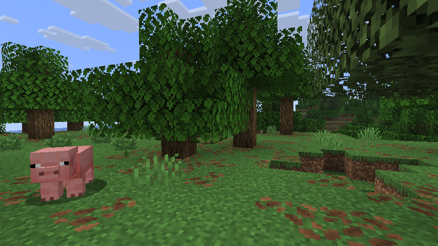
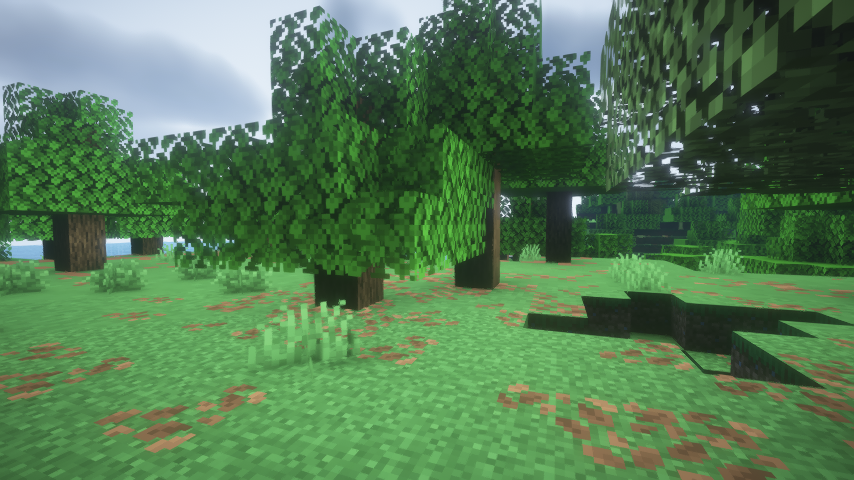
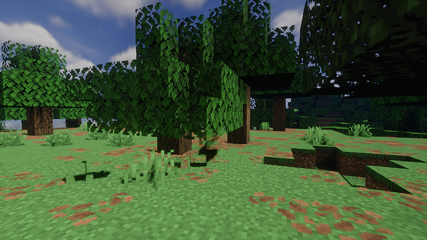
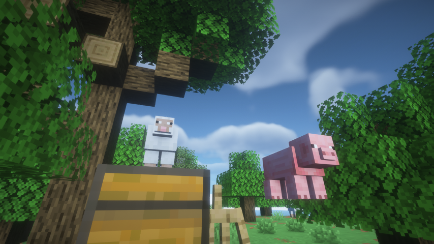
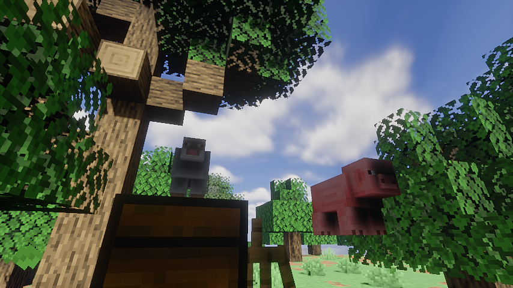

# Phase 7 — gbuffers: status (slices 7a + 7b + 7c)

7a + 7b (terrain) are below; 7c (entities, block entities, sky, particles) is at the end:
[Slice 7c](#slice-7c--vanilla-geometry-with-the-packs-programs).

**Result: on Polydium's live in-world frame, 10 / 10 real shader packs draw the world's terrain with their own
`gbuffers_terrain` / `_cutout` / `gbuffers_water` programs, natively on Vulkan.** Their deferred / composite / final
chain then runs on that gbuffer data. Tested on an RTX 5060 (NVIDIA 610.88, Vulkan 1.4.341), Minecraft 1.21.11, Polydium 1.4.21 and Sodium 0.8.14.

Test: `./gradlew :fabric:prodPhase7` (`-Dvulkaniris.phase7.selftest`), optionally `-Dvulkaniris.phase6.packs=bsl,noble`.
It uses the same world as Phase 6 (`vulkaniris-phase6`, seed 6). For each pack it builds the chain and its terrain programs, then
switches Sodium to the pack's vertex format and rebuilds every chunk. It waits 240 frames for the rebuild, records 90 more frames, then saves
`run-prod/vulkaniris-phase7/<pack>.png` and `run-prod/vulkaniris-phase7.txt`.

A pack passes when all of these hold:
- every program built
- every terrain pass drew with the pack's program, with no error
- the output is not flat
- the screenshot was checked by eye

In the same session the Phase 6 test (`prodPhase6`) still passes 10 / 10.

| Pack | Terrain programs used | Vertex stride | Result |
|---|---|---|---|
| Bliss 2.1.2 | gbuffers_terrain, gbuffers_terrain, gbuffers_water | 32 B | pass |
| BSL 10.1.3 | gbuffers_terrain, gbuffers_terrain, gbuffers_water | 32 B | pass |
| Complementary Reimagined r5.9.3 | gbuffers_terrain, gbuffers_terrain, gbuffers_water | 32 B | pass |
| Complementary Unbound r5.9.3 | gbuffers_terrain, gbuffers_terrain, gbuffers_water | 32 B | pass |
| MakeUp UltraFast 9.4b | gbuffers_terrain, gbuffers_terrain, gbuffers_water | 32 B | pass |
| Mellow 3.5 | gbuffers_terrain_solid, gbuffers_terrain, gbuffers_water | 32 B | pass |
| miniature 2.19 | gbuffers_terrain, gbuffers_terrain, gbuffers_water | 32 B | pass |
| Noble 1.9.9 | gbuffers_terrain, gbuffers_terrain, gbuffers_water | 36 B | pass |
| Sildur's Vibrant 2.02 Extreme | gbuffers_textured, gbuffers_textured, gbuffers_water | 32 B | pass |
| Solas 3.7b | gbuffers_terrain, gbuffers_terrain, gbuffers_water | 32 B | pass |

Each pack drew 988–990 terrain passes over 330 frames. No region was skipped for being in the old vertex format.
The run exits cleanly, with no device loss and 0 images leaked.

| Vanilla (Polydium) | BSL | Complementary Reimagined | Noble |
|---|---|---|---|
|  |  |  |  |

More screenshots: [Bliss](phase7/bliss.png), [Solas](phase7/solas.png), [Sildur's](phase7/sildurs.png).
The camera differs a little from pack to pack because the player settles while chunks rebuild.

## How it works
**7a — extended chunk vertices.** Polydium strips all of Iris's mixins on Vulkan. Vulkan Iris re-applies the CPU-side
ones that put Iris's data into Sodium's chunk vertices:
- `MixinChunkVertex`, `MixinChunkVertexConsumer`, `MixinChunkMeshBuildTask`
- the block and fluid renderers (including the Fabric `FluidRendererImpl` one)
- `MixinAbstractBlockRenderContext`, `MixinBlockModelPart`
- `MixinRenderRegionArenas`, `MixinRenderSectionManager`

They are copied from Iris (LGPL, credited in each file) as `*Port` mixins. `VulkanIrisMixinPlugin` applies them only when
Polydium's `IrisVulkanGate.applied` is true, so they never duplicate Iris's own. Iris's `FormatAnalyzer` picks the format from the
attributes the pack's programs read (`mc_Entity`, `iris_Normal`, `mc_midTexCoord`, `at_midBlock`), as Iris does after linking.
Chunks are then rebuilt with `LevelRenderer.allChanged()`.

**7b — terrain drawn with the pack's programs.** `MixinSodiumVulkanPort` intercepts Polydium's private `SodiumVulkan.draw`.
That method is called after Sodium's batches, the index buffer capacity and the chunk data are prepared. `TerrainHook` walks the
same regions and batches Polydium would. These facts were read from Polydium's bytecode; none of its code is copied:
- regions without storage, resources or a batch are skipped
- the index buffer is the shared quad buffer, or the region's own for sorted translucency
- region offset = (origin − camera int) − camera fraction
- time = now − region creation time

`PostChain` then draws each region with the pack's program:
- **Programs:** Iris's `ProgramFallbackResolver` for TerrainSolid / TerrainCutout / Water, `patchSodium`, then `VulkanGlslTranslator`.
  `u_RegionOffset` and `iris_CurrentTime` become push constants.
- **Uniforms:** a second uniform writer with Iris's `SodiumShader` set: PER_VERTEX fog, builtin replacements, the model-view / projection /
  normal matrices and their inverses, `u_TexCoordShrink`, `iris_TexelSize`, and the alpha test reference (Iris's defaults:
  none / half / non-zero).
- **Samplers:** Iris's `addGbufferOrShadowSamplers` rules:
  - atlas and lightmap: Polydium's own textures
  - colortex4+ only; colortex0–3 are not sampleable in gbuffers on Iris, so they read texture unit 0, the atlas
  - custom textures of the gbuffers stage
  - `normals` / `specular`: Iris's flat defaults
  - `iris_ChunkData`: Polydium's per-region chunk-fade buffer
- **Pipeline:** the vertex format is Sodium's compact layout plus Iris's attributes, at FormatAnalyzer's offsets.
  - Depth test LEQUAL with depth writes; back faces culled.
  - Front face is clockwise: Polydium keeps GL's row order without a y flip, which mirrors GL's winding.
  - Blending: Sodium's translucent blend for water, plus the pack's blend directives.
- **Draw:** one descriptor set per region, because each region's chunk data differs. Then indexed draws from the region's batch.
- **Frame split:** the chain now runs in three parts recorded between Polydium's passes, each wrapped in Polydium's full barrier:
  - `beginLevel` (begin, prepare) at the first terrain draw
  - `beforeTranslucent` before water: the depth copy for depthtex1, centre depth, and deferred, where Iris runs it
  - `endLevel` (composite, final, copy-back) after the world

### Found and fixed on the way
- **Unused inputs and samplers.** GL drops inputs and samplers that are declared but never read; the translator now drops them too.
  Before, BSL's `at_tangent` (renamed by Iris's patch) and Complementary's unused `colortex6` made pipelines fail.
- **Feedback loop.** Sildur's `gbuffers_water` really samples colortex4 while drawing into it, a GL feedback loop.
  It now samples a copy taken just before the pass, which is what GL returns in practice (reported in the notes).
- **Composite blend directives.** These are now implemented; Phase 6 ignored them. Noble's exposure and bloom passes need them: without them Noble's image was washed out to white.
- **Test harness: destroying too early.** The harness destroyed a pack's chain, and at the end every Vulkan object, while the
  frame being recorded still referenced them. This caused a device loss on the second pack and a rare crash at shutdown.
  Destruction now waits for that frame's submission.
- **Stale vertex stride.** Each region's arena stride is checked: a region still meshed in another format is skipped, never read
  past its end. None occurred in the tests.

## Not implemented yet (reported in the notes, never faked)
- **7c leftovers** (see the 7c section below):
  - clouds: the `CloudFaces` texel buffer isn't bound yet, so clouds stay with Polydium (packs draw their own in composite)
  - the hand: Iris draws it in its own pass after the world (`HandRenderer`), not ported
  - Iris's extended entity vertex format (`iris_Entity`, entity `mc_midTexCoord` / `at_tangent`) reads GL's default (0,0,0,1)
  - Iris's synthesized fallback shader for keys a pack has no program for
- **7d:** no shadow pass: `shadow*` samplers are a "nothing occludes" stand-in, and `shadowcomp` doesn't run.
- **depthtex in gbuffers:** depthtex0/1/2 read the depth before translucent terrain. In the opaque passes that is the previous frame's copy.
  GL would sample the depth buffer being drawn.
- **PBR:** `normals` / `specular` atlases are not loaded; Iris's defaults are used.
- **Not driven yet:** tessellation in terrain programs, per-region descriptor-set reuse (a performance item),
  `blendFunc`, and the `gbufferPrevious*` uniforms Iris itself doesn't provide.
- **Validation:** the Khronos validation layer has still not been run (not installed on the test machine).
  Only NVIDIA has been tested.
- **No benchmark yet.** The test's CPU record times (0.1–2.7 ms per frame for the whole chain) are not a benchmark.

# Slice 7c — vanilla geometry with the pack's programs

**Result:** entities, block entities, the sky (sky disc, sunrise/sunset, stars, sun and moon), particles and the entity
shadow decal are now drawn with the pack's `gbuffers_entities` / `_block` / `_skybasic` / `_skytextured` / `_textured(_lit)`
programs into the colortex targets, on Polydium's live frame. **10 / 10 packs pass** `prodPhase7` with no vanilla draw
error. Over 330 frames each pack draws about 3,000–3,300 entity draws, 660–1,650 sky draws and 330–420 particle draws
with its own programs (miniature: none, see below), in about 5,000–5,600 redirected Polydium passes. `prodPhase6` still passes 10 / 10. The run exits with 0 images leaked.
Screenshots were checked by eye; every pack is set to noon at its start.

| BSL | Complementary Reimagined | Noble |
|---|---|---|
|  |  |  |

More: [Bliss](phase7/7c-bliss.png), [Solas](phase7/7c-solas.png), [Sildur's](phase7/7c-sildurs.png). Not every pack
has every program; Iris's fallback chain decides which one draws, e.g. Sildur's draws entities with `gbuffers_textured`
and Solas the sky with `gbuffers_basic`.

**Gap found:** when a pack has no program anywhere in a key's fallback chain, Iris draws with its own synthesized
fallback shader. That fallback isn't implemented on Vulkan yet. Those draws stay with Polydium, in the main colour, which
the pack's final pass overwrites. So in miniature, particles, the sun and the moon are missing. The notes list every
affected key per pack.

The test now summons a pig, a sheep and an armor stand and places a chest in front of the player (vanilla commands
on the integrated server; earlier runs' entities, tagged `vi7c`, are removed first). The report lists, per pack, the
draws per pack program and every vanilla pipeline seen while the pack was active.

## How it works
- **Which program:** Iris's own mapping, `IrisPipelines.getPipeline(pipeline)` → `ShaderKey`, then Iris's
  `ProgramFallbackResolver` for that key's program. Each key is patched with Iris's `patchVanilla`, translated with
  `VulkanGlslTranslator` and compiled once per pack; pipeline variants (vertex format, blend, depth, cull) are built at
  a pipeline's first draw.
- **Where it hooks** (facts read from Polydium 1.4.21's bytecode; nothing copied):
  - `VulkanCommandEncoder.createRenderPass(descriptor)` and `VulkanDeferral.continueSuspendedPass(descriptor)` — Polydium
    merges consecutive passes on the same targets, so most world passes come from the second one. A pass is redirected
    when its single colour attachment is Minecraft's main colour and its depth (if any) the main depth.
  - `VulkanRenderPass.drawIndexed(IIIII)` / `draw(IIII)`: every non-indirect draw ends in one of these.
- **The swap:** at the first redirected draw Polydium's dynamic-rendering scope is ended. The same draw (same vertex and
  index buffers, same `vkCmdDraw*` arguments, same `DynamicTransforms` / `Projection` / `Fog` / `Globals` uniform blocks and
  the bound textures) is recorded with the pack's pipeline into its `DRAWBUFFERS` + the main depth. Before Polydium's next own
  draw, multi-draw, indirect draw, push constant or `close()`, its scope is begun again with the same attachments
  (load/store), its pipeline, viewport and scissor re-bound and its `VulkanDynamicState` cache reset.
- **Sky:** Polydium draws the sky with its own far-plane copies of vanilla's sky pipelines (public constants in
  `SkyFarPlane.Pipelines`). They are mapped back to the vanilla pipeline they replace, so the pack's sky programs run
  with vanilla's state, as on GL.
- **Frame start:** the pack's frame now begins at `LevelRenderer.renderLevel` HEAD, because the sky is drawn before terrain.
- **Inputs vanilla formats don't have** (e.g. `iris_UV1` for particles, `mc_Entity`) read a constant vertex binding
  with GL's default attribute value (0,0,0,1), as GL does for a disabled attribute.

## Limits (all reported in the notes)
- clouds, the hand, Iris's extended entity attributes: see "Not implemented yet" above
- no block entity vs entity phase tracking yet (Iris's `blockEntityId` / `entityId` uniforms are not driven)
- a program that samples a target it draws into reads a copy taken at its first draw of the frame
- the uniform block is filled once per program per frame
- performance items, not measured: one descriptor set per draw; pipeline variants built lazily at first use
  (a stutter the first time a pipeline is seen); legacy (non-dynamic-rendering) Polydium passes are not handled
