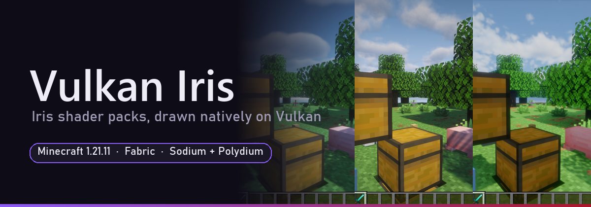
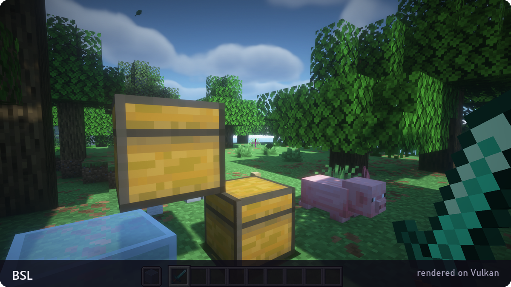
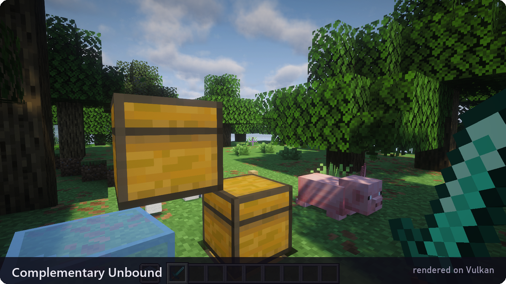
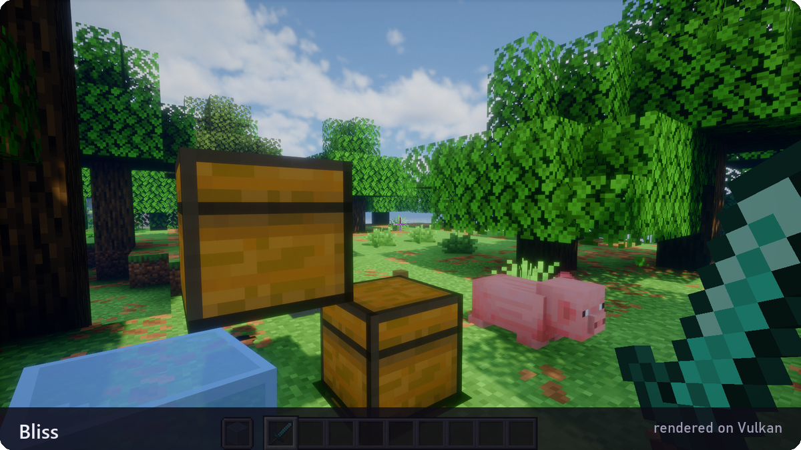
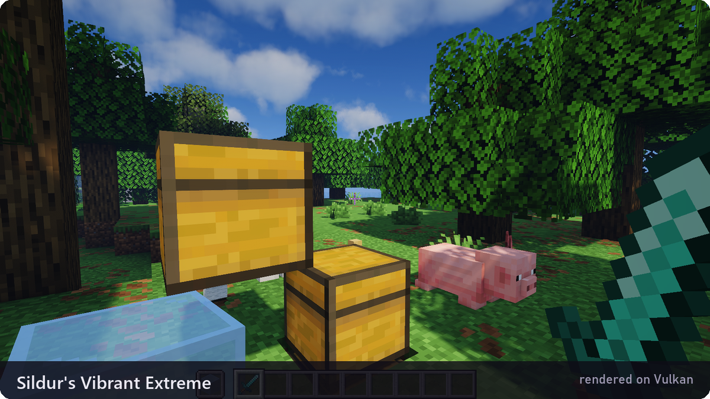
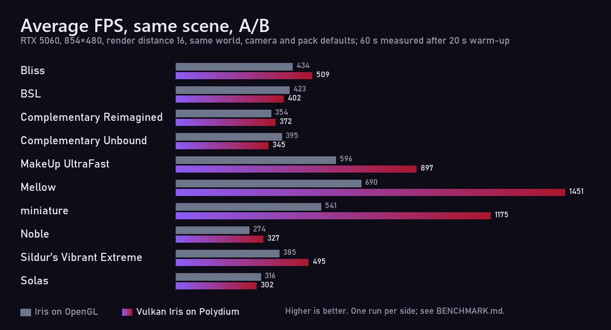

**Vulkan Iris** is a fork of **Iris Shaders** that draws your OptiFine/Iris shader packs **natively on Vulkan**. It runs together with **Polydium**'s Vulkan backend. Normally, switching Polydium to Vulkan means giving up shaders. With Vulkan Iris you keep them.

**Beta:** Minecraft **1.21.11**, Fabric. Tested on an NVIDIA RTX 5060. AMD and Intel GPUs should work but have not been tested yet. Please report how it runs on yours.

---

## What it does

- **Real Vulkan rendering, no OpenGL translation layer.** Pack shaders are compiled to SPIR-V and drawn with Vulkan pipelines inside Polydium's frame.
- **The whole Iris pipeline:**
  - terrain, entities, block entities, hand, sky, clouds and particles drawn with the pack's own gbuffers programs
  - the shadow pass and shadowcomp
  - deferred, composite and final
  - compute shaders, custom images and SSBOs
  - per-buffer blending, size.buffer, and mipmapped buffers for bloom
- **It is Iris.** Pack loading, options, profiles and the shader pack screen are Iris's own. Mods that check for Iris see it.
- **Same controls:** **O** opens the shader pack screen, **R** reloads, **K** toggles shaders.
- **Safe failure.** If a pack can't be drawn, you get a chat message and keep playing with Polydium's normal rendering. The game doesn't crash.
- **OpenGL still works.** Without Polydium on Vulkan, the jar behaves exactly like Iris 1.10.8 on OpenGL.

---

## Performance

**Faster in 7 of the 10 packs tested.** Mellow and miniature run more than twice as fast, MakeUp UltraFast +50 %, Sildur's Vibrant +29 %, Noble +19 %, Bliss +17 % and Complementary Reimagined +5 %. Three packs are still slower: BSL −5 %, Solas −5 % and Complementary Unbound −13 %. With shaders off, Polydium's Vulkan backend is about 2.7× faster than OpenGL.

*Average FPS, RTX 5060, 854×480, render distance 16.*

Every number comes from an automated A/B run: same jar, same world, same camera, same pack options. A is Iris on OpenGL; B is Vulkan Iris on Polydium. The full benchmark, with 1 % lows, per-stage GPU times and where Vulkan Iris is still slower, is on GitHub: https://github.com/mattron1c/Vulkan-Iris/blob/main/docs/vulkan-iris/BENCHMARK.md. Your results will differ with your GPU, resolution and settings.

---

## Install

1. Install **Fabric** for **Minecraft 1.21.11**, plus **Fabric API**, **Sodium 0.8.x** and **Polydium** (1.4.21 or newer).
2. Put **Vulkan Iris** in your mods folder **instead of** Iris. Don't install both.
3. In game, go to Video Settings → General → Graphics API and choose **Vulkan**, then restart.
4. Drop shader packs into shaderpacks/, press **O**, pick one and press Apply.

---

## Compatibility

**Shader packs tested** (all render on Vulkan in the automated tests): Bliss, BSL, Complementary Reimagined, Complementary Unbound, MakeUp UltraFast, Mellow, miniature, Noble, Sildur's Vibrant and Solas.

**Mods tested** side by side in the automated in-game test: select, reload, toggle and switch packs, resize, quit.
Two real mods folders, each run in full alongside Vulkan Iris (271 and 339 mods, counting libraries and Fabric API modules). Among them: Sodium Extra, Reese's Sodium Options, Lithium, C2ME, ModernFix, FerriteCore, ImmediatelyFast, EntityCulling, MoreCulling, ScalableLux, Krypton, VMP, BadOptimizations, Debugify, ThreadTweak, Entity Model Features, Entity Texture Features, Essential, Litematica, Bobby, Flashback, Simple Voice Chat, Sound Physics Remastered, Presence Footsteps, AppleSkin, Mod Menu, YACL, Cloth Config, OneConfig, spark, Not Enough Crashes, No Chat Reports.

Passing means the mods load and run together through those steps, not that every feature of every mod has been checked with every pack. Full lists: https://github.com/mattron1c/Vulkan-Iris/blob/main/docs/vulkan-iris/COMPATIBILITY.md

**Not compatible:**
- **Iris** itself: Vulkan Iris replaces it.
- **OptiFine**.
- **VulkanMod**: a different Vulkan renderer.
- **Distant Horizons** and **Voxy**: they draw with OpenGL themselves, so they need Polydium on OpenGL, where Vulkan Iris is plain Iris.

**Minecraft versions:** 1.21.11 only. Polydium's Vulkan backend is what makes this possible, and every Minecraft version needs its own build. Older versions have no Polydium. From 26.2 on, Minecraft has Vulkan built in and Iris supports it upstream.

---

## Known limits

Vulkan Iris doesn't do these yet:
- tessellation shaders (packs that *require* them are refused with Iris's normal "unsupported" message)
- viewport scale and polygon modes other than fill
- mipmapped shadow buffers
- Iris's extended entity IDs

A pack that uses one of these still loads. That one feature falls back to its default, and the game log says which.

---

## FAQ

**Is it faster than Iris?** Usually. In our tests it's faster in 7 of 10 packs, from +5 % to more than double, and up to 13 % slower in the other 3 (BSL, Solas, Complementary Unbound). How much you gain depends on the pack and your GPU.

**Do I need Polydium?** For Vulkan, yes. Without it, Vulkan Iris is ordinary Iris on OpenGL.

**My pack shows a red chat message.** Vulkan Iris couldn't draw it and switched back to normal rendering. Press R to retry, and please open an issue on GitHub with your latest.log.

**Why a fork and not a pull request to Iris?** Upstream Iris targets Minecraft's own Vulkan from 26.2 on. Vulkan Iris brings Vulkan shaders to 1.21.11 through Polydium.

---

## Credits & license

Vulkan Iris is built on **Iris** by coderbot, IMS212 and the Iris contributors, and is licensed like Iris under **LGPL-3.0**. It needs **Sodium** (CaffeineMC) and **Polydium** (Polyfrost), which it calls but does not include or copy. It is **not affiliated** with Iris, Sodium, Polyfrost or Mojang.

Source code and issues: https://github.com/mattron1c/Vulkan-Iris
